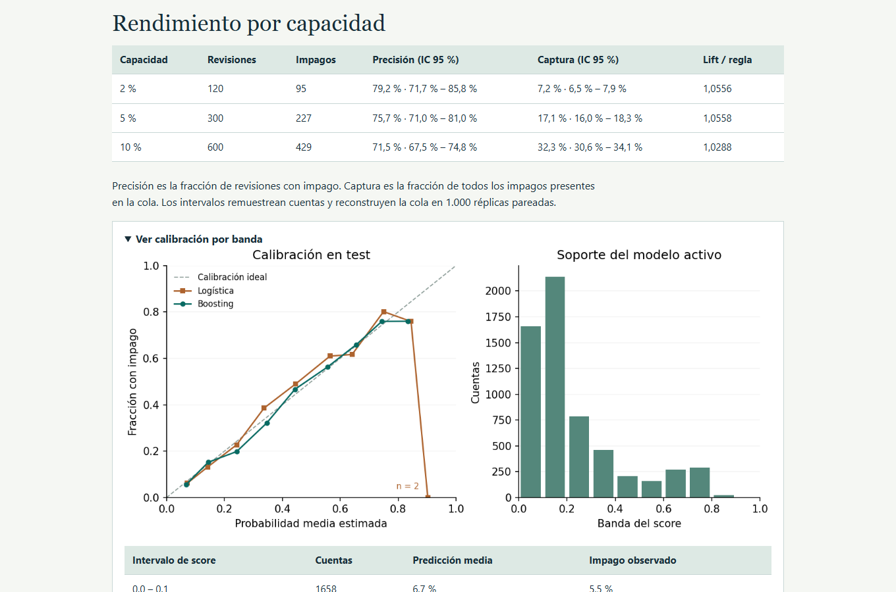

# Priorización de cuentas

**Data Science** · Datos históricos · Taiwán, 2005 · [English](README.md) · [Portafolio de Jorge Alarcón](https://github.com/jorgealarcon07/jorgealarcon07/blob/main/README.es.md#proyectos)

   

## Si solo podemos revisar 300 cuentas, ¿por cuáles empezamos?

Construí una cola de revisión y comparé una regla de atraso con dos modelos. El equipo de riesgo puede ver qué cambia al dedicar más o menos revisiones. El boosting ordenó mejor el conjunto completo y cumplió el criterio de selección fijado de antemano. Con el cupo concreto de 300, la regresión logística reunió más impagos observados. Esa diferencia importa al dimensionar el equipo. La muestra es histórica y de una sola cohorte.

**Resultado medido.** Entre las primeras 300 de 6.000 cuentas de prueba hubo 232 impagos históricos con regresión logística, 227 con boosting y 215 con la regla de atraso.

[Abrir el informe en el navegador](https://jorgealarcon07.github.io/jorgealarcon07/revision-de-riesgo/) · [Leer el caso de estudio](CASO_DE_ESTUDIO.md) · [Ver la arquitectura](docs/ARQUITECTURA.md)



## Cómo se construyó

Separé las 30.000 cuentas por etapas de entrenamiento, selección y prueba. Con scikit-learn ajusté los modelos y calibré sus probabilidades. MLflow conserva los experimentos y PostgreSQL publica una versión de la cola que se puede auditar.

[Comparación y límites del modelo](model_card.md) · [Decisión y versiones](reports/release/decision_record.json) · [Experimentos de MLflow](reports/release/tracking.json)

## Revisar en cinco minutos

1. Abra el [informe HTML](reports/release/policy_report.html) desde el explorador de archivos. Compare los modelos, la tabla de capacidad y los intervalos. El informe funciona sin red ni cuenta.
2. Consulte el [registro de decisión con huellas SHA-256](reports/release/decision_record.json) y la [selección previa al test](reports/release/selection_frozen.json).
3. Siga una fila de la [cola histórica](reports/queue.csv) mediante su fecha, namespace, versión y huella de features. La [aceptación PostgreSQL](reports/acceptance.json) contrasta esa cola con los resultados observados.
4. Revise el [lote sintético](data/fixtures/synthetic.csv) y su [prueba de bloqueo](reports/demo.json). El video y las [capturas](assets/web) sirven para presentar la demo en una entrevista.

## Instalación local

Desde la raíz del repositorio, con CPython 3.12 de 64 bits. Para abrir el HTML se puede omitir la instalación. Los comandos siguientes usan PowerShell.

```powershell
py -3.12 -m venv .venv
.\.venv\Scripts\Activate.ps1
python -m pip install -r requirements.lock
python -m pip install --no-build-isolation --no-deps -e .
python -m pip check
faro-risk validate
```

En Linux use `python3.12 -m venv .venv` y `source .venv/bin/activate`. Trabaje desde la raíz para que la CLI encuentre contratos y release. La primera instalación necesita acceso a PyPI. El modelo y la referencia de monitor ya están incluidos. Joblib requiere artefactos de una revisión de confianza.

### Demo con PostgreSQL

En una base **dedicada** de PostgreSQL 17 configure `PGHOST`, `PGPORT`, `PGDATABASE`, `PGUSER` y la contraseña mediante el entorno o el archivo de contraseñas de libpq. El propietario inicial debe poder crear esquemas. El ejemplo de variables está en [.env.example](.env.example). Ejecute desde una sesión con esas variables exportadas.

```powershell
faro-risk demo --out local/demo
faro-risk queue --namespace credit_simulated_v1 --as-of 2026-01-31 --out local/queue.csv
faro-risk score --csv data/fixtures/synthetic.csv --namespace credit_simulated_v1 --as-of 2026-01-31 --out local/replay.json
```

La demo genera 500 cuentas sintéticas, publica 25 posiciones y reenvía el lote desordenado. Luego altera límites y columnas. `demo.json` registra el estado, la primera cuenta y las causas de suspensión. Para la ruta nativa con instalación de PostgreSQL pero sin servidor en marcha, el siguiente comando inicia un clúster local aislado, ejecuta la demo y lo detiene.

```powershell
python scripts/native_pg.py --bin "C:\Program Files\PostgreSQL\17\bin" -- -m faro_risk.cli demo
```

En Docker Compose, defina previamente `PGPASSWORD` en el entorno o un archivo local `.env` excluido de Git. Ejecute `docker compose run --build --rm app demo`. La salida vive en el volumen de trabajo nombrado. Para copiar los resultados al host, use `docker compose run --name faro-risk-export app demo`, `docker cp faro-risk-export:/app/local/demo ./demo-export` y `docker rm faro-risk-export`. La operación de parada habitual es `docker compose down`. El host de verificación solo dispuso de PostgreSQL nativo.

## Reconstruir la evidencia histórica

```powershell
faro-risk download --zip local/uci.zip
faro-risk study --zip local/uci.zip --release local/release-01 --work local/tracking-01
faro-risk validate --release local/release-01
python scripts/reproduce_fit.py --zip local/uci.zip
faro-risk export-holdout --zip local/uci.zip --out local/holdout.csv
faro-risk score --csv local/holdout.csv --namespace uci_tw_credit_2005 --as-of 2005-09-30 --out local/historical.json
faro-risk queue --namespace uci_tw_credit_2005 --as-of 2005-09-30 --out local/historical-queue.csv
```

`study` exige una **carpeta de release nueva**. La copia archivada del ZIP sirve si coincide el SHA-256. `export-holdout` y `score` usan por defecto la release entregada. Para usar una reconstrucción, indique la misma opción `--release local/release-01` en ambos comandos y una base de prueba nueva si el snapshot ya existe. La segunda comprobación de entrenamiento compara solo validación. [Fuente, licencia y transformaciones](DATA_SOURCES.md)

El tracking de MLflow usa SQLite en `--work/tracking.sqlite` y un almacén local de artefactos. Consulte las cinco ejecuciones hijas, los parámetros y artefactos con `MlflowClient(tracking_uri="sqlite:///local/tracking-01/tracking.sqlite")`. La [exportación del run](reports/release/tracking.json) permite revisarlo sin ese servicio.

## Pruebas y operación

```powershell
ruff check .
ruff format --check .
python -m pytest -q
python scripts/native_pg.py --bin "C:\Program Files\PostgreSQL\17\bin" -- scripts/acceptance.py --zip local/uci.zip --out local/acceptance
```

El último comando usa un clúster nuevo y ejecuta la suite completa, los fallos sembrados, dos envíos concurrentes, permisos de auditoría y la comparación entre la cola SQL y el holdout. En una base dedicada vacía con permisos de administrador y variables PG configuradas puede ejecutar directamente `python scripts/acceptance.py --zip local/uci.zip`. Los tests PostgreSQL se omiten si falta `PGDATABASE`. [JUnit verificado](reports/tests.xml) · [Resultados de reproducibilidad](reports/refit.json)

La CLI también ofrece `report`, `audit-import` y `clean --confirm`. [Arquitectura y diccionario](docs/ARQUITECTURA.md) · [Contratos y soporte operativo](docs/RUNBOOK.md) · [Estándares](ESTANDARES_INGENIERIA.md) · [Comprobación de cumplimiento](docs/CUMPLIMIENTO.md)

## Procedencia

I-Cheng Yeh. *Default of Credit Card Clients*. UCI Machine Learning Repository, CC BY 4.0. Los derivados conservan atribución. El código original se distribuye bajo MIT. El ensayo mide concentración histórica de impagos en Taiwán. Para estimar utilidad actual en Colombia harían falta validación local y evidencia del efecto de la intervención. [UCI y licencia](DATA_SOURCES.md)
