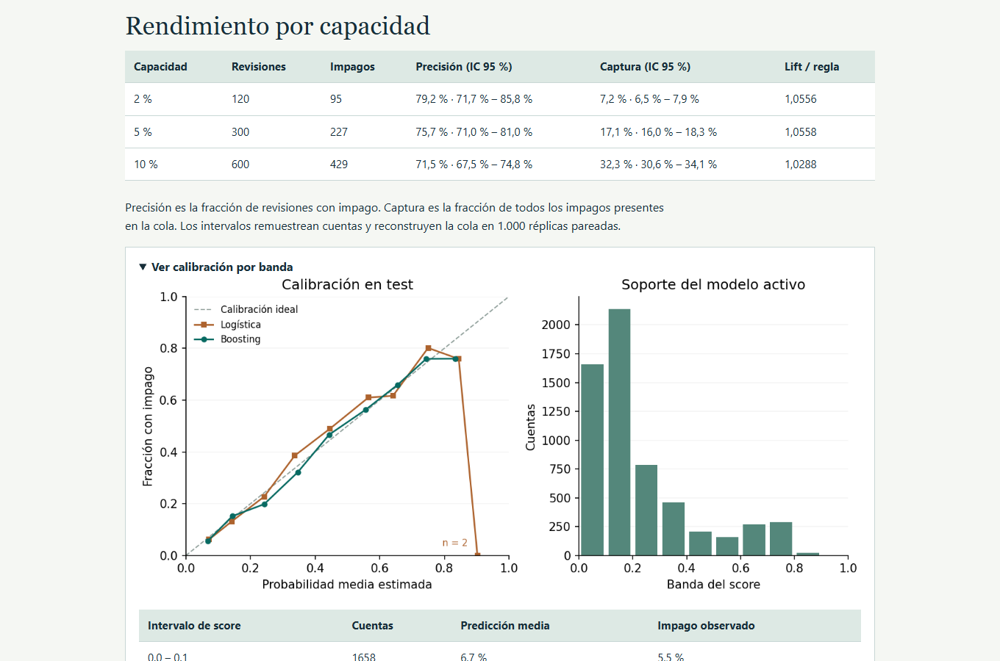

# Account review prioritization

**Data Science** · Historical credit-card data from Taiwan, 2005 · [Español](README.es.md) · [Portfolio](https://github.com/jorgealarcon07#projects)

   

## If the risk team can review only 300 accounts, where should it start?

I built a ranked queue for a fictional team that reviews accounts manually. I compared two models and an overdue-payment rule to see how the ranking changes as the team can review more or fewer accounts.

**Measured result.** In the first 300 of 6,000 historical test accounts, logistic regression surfaced 232 observed defaults, calibrated gradient boosting surfaced 227 and the overdue-payment rule surfaced 215. Boosting achieved the best average precision across the full ranking. The historical study measures which defaults each method would have surfaced for review.

[Case study](CASE_STUDY.md) · [Open interactive report (Spanish)](https://jorgealarcon07.github.io/jorgealarcon07/revision-de-riesgo/) · [Architecture (Spanish)](docs/ARQUITECTURA.md)



## How it works

Separate sets of accounts support training, model selection and final evaluation. scikit-learn fits the models and calibrates their probabilities. MLflow records experiment parameters and artifacts. A batch process publishes timestamped scores with input hashes to PostgreSQL and exposes the review queue as a SQL view. A repeated batch reuses the published snapshot.

[Model card (Spanish)](model_card.md) · [Decision record](reports/release/decision_record.json) · [Experiment tracking export](reports/release/tracking.json) · [English walkthrough transcript](assets/web/walkthrough.en.txt) · [Data and licensing notes (Spanish)](DATA_SOURCES.md) · [CI runs](https://github.com/jorgealarcon07/faro-risk-policy/actions)

## Run the synthetic demo

Use Python 3.12 and a dedicated PostgreSQL 17 database. Configure the connection with [.env.example](.env.example) as a reference. The database user needs permission to create schemas. Run from the repository root in PowerShell. On Linux or macOS, use `. .venv/bin/activate`.

```powershell
py -3.12 -m venv .venv
.\.venv\Scripts\Activate.ps1
python -m pip install -r requirements.lock
python -m pip install --no-build-isolation --no-deps -e .
python -m pip check
faro-risk validate
faro-risk demo --out local/demo
```

Inspect `local/demo/demo.json` for the published queue, replay and blocked input. The [full guide in Spanish](README.es.md) covers the self-contained PostgreSQL runner and the historical study.
