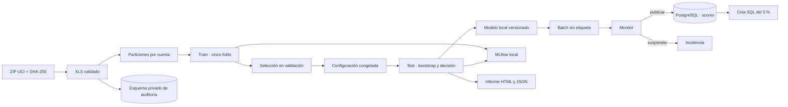

# Arquitectura y diccionario

## Fronteras de datos

| Capa | Grano y contenido | Quién lo utiliza |
|---|---|---|
| Archivo fuente | Una cuenta con historial, cuatro campos demográficos, ID y etiqueta | Adaptador de estudio y carga privada autorizada |
| Split | Una fila por ID y partición, semilla 2026 | Evaluación y exportador histórico |
| Batch de entrada | ID y exactamente 19 columnas de historial. Sin etiqueta o demografía | Operación de scoring |
| Matriz de modelo | 19 columnas de historial más cuatro derivadas. Las seis categorías se codifican dentro del pipeline | Estimador |
| Auditoría por cuenta | ID, códigos originales de sexo, educación, estado civil, edad y SHA del origen. Esquema privado e importación explícita | Rol de auditoría |
| Score | Probabilidad por cuenta y corte. El snapshot padre conserva versión, huella de features, namespace, run MLflow y grano | Servicio batch |
| Cola | Primeros floor(0,05 × n) por score descendente y SHA-256 de ID como desempate fijo | Lector de revisión |
| Reporte | Métricas y grupos agregados con conteos e intervalos | Líder de riesgo y reclutador |

## Variables y disponibilidad

| Campo | Semántica y transformación |
|---|---|
| LIMIT_BAL | Límite de crédito positivo en TWD. |
| PAY_0, PAY_2 … PAY_6 | Estados desde septiembre hasta abril. Conservar códigos tal como aparecen. En el modelo se tratan como categorías y se usa OneHotEncoder con tolerancia a categorías nuevas. La regla operativa ordena el código original. |
| BILL_AMT1 … BILL_AMT6 | Saldos mensuales en TWD, más reciente primero. Se conservan 3.932 celdas negativas observadas. |
| PAY_AMT1 … PAY_AMT6 | Pagos mensuales en TWD, más reciente primero. |
| late_months | Número de meses con código mayor que cero. Si todos faltan, se conserva faltante antes del pipeline. |
| unmapped_statuses | Número de estados presentes fuera de −1 y 1…9, dominios descritos por UCI. No atribuye significado a −2 ni a 0. |
| bill_limit | Saldo de septiembre entre límite. Se conserva signo. |
| paid_prior_bill | Pago de septiembre entre saldo de agosto. Denominador cero produce faltante. No representa el porcentaje efectivamente cobrado. |
| SEX, EDUCATION, MARRIAGE, AGE | Solo auditoría. Códigos de origen, edad en años y bandas descriptivas. Umbral 100 en el informe. |
| default payment next month | Etiqueta binaria. Solo entrenamiento y evaluación de resultados maduros. |

Los importes, estados y ratios se calculan con el historial disponible hasta septiembre. Los imputadores, escaladores y categorías aprendidas se ajustan en el pipeline de cada fold. Se imputan por mediana las columnas numéricas y se agregan indicadores cuando en el ajuste hay faltantes. El ZIP real contiene 30.000 IDs únicos y ninguna celda vacía. En educación se observaron los códigos 0, 5 y 6 fuera de la ficha y en estado civil el código 0. [Perfil completo](../reports/release/profile.json)

## Protocolo científico

Se ordenan las cuentas por ID antes del split estratificado para que el orden del archivo no cambie las particiones. Se calcula la AP interna de cinco folds para C ∈ {0,01, 0,1, 1} y dos boosting con 7 o 15 hojas. Las configuraciones se comparan en validación. La calibración sigmoidal del boosting usa predicciones fuera de fold en entrenamiento. Las medidas de CV registradas corresponden al estimador base, y la comparación en validación al modelo final de cada configuración. Se mantiene la distribución natural. [Prácticas de sklearn](https://scikit-learn.org/stable/common_pitfalls.html) · [Calibración](https://scikit-learn.org/stable/modules/generated/sklearn.calibration.CalibratedClassifierCV.html)

Tras congelar selección y artefactos, cada método puntúa el mismo test. La regla de mora carece de escala probabilística, por eso sus celdas de Brier y log loss quedan vacías. Para precisión, captura y lift se reconstruye la cola en cada remuestra de cuentas. Los intervalos son percentiles pareados al 95 %. El remuestreo describe incertidumbre condicional a esos modelos y esa cohorte. Las bandas de calibración son deciles de anchura fija del score y conservan el número de cuentas, incluso en bins vacíos.

## Persistencia y recuperación

El código de negocio vive en funciones de preparación, métricas y política. Un adaptador se encarga de I/O para el XLS, otro del SQL y otro del tracking. Los estimadores comparten los pipelines de preprocesamiento. MLflow registra una ejecución padre y cinco hijas con parámetros, métricas y artefactos. SQLite se usa para el tracking local y PostgreSQL para la interfaz transaccional. [Tracking MLflow](https://mlflow.org/docs/latest/ml/tracking/)

La huella del lote corresponde a CSV canónico con columnas en orden de contrato y filas ordenadas por ID. El ID solo interviene en unicidad, enlace y desempate. La transacción adquiere un bloqueo por namespace y fecha. Inserta cabecera y scores, o revierte ambos. Un replay con el mismo modelo y contenido devuelve el snapshot existente. Cambiar el modelo o el contenido en esa fecha produce colisión. La vista ordena con la misma clave de desempate que Python. [SQL](../src/faro_risk/sql/v1.sql) · [Contratos versionados](../contracts/v1)

La calibración y el monitoreo de esta cohorte carecen de validación longitudinal. La entrega usa una única máquina, un lote y PostgreSQL local. Esta escala permite verificar reproducibilidad y recuperación sin infraestructura distribuida.
